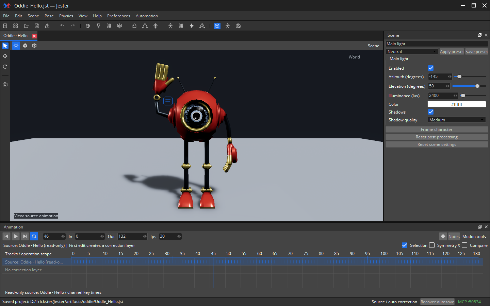

# Jester

Native projects use **[.jst](docs/PROJECTS.md)**.

A character animation editor powered by **O3DE Atom (DX12 / Vulkan)** and Qt. First public alpha: **0.1.0-alpha.1**.



FBX/glTF import, FK/IK posing, keyframes, curves, correction layers, retargeting, notes, and experimental MuJoCo physics. Evolved from [Trickster](https://github.com/Atmosaero/Trickster).

Windows x64 · O3DE SDK 26.10 · Visual Studio 2026 (C++) · SDK-provided Qt 6.10.2.

```powershell
./build.ps1 -EngineRoot D:/O3DE -Assets
./launch.ps1 -Demo
```

Early alpha: CPU skinning and basic lighting. See [building](docs/BUILD.md), [portable packaging](docs/PACKAGING.md), [testing](docs/TESTING.md), and [limits](docs/LIMITATIONS.md).

MIT · [Third-party notices](THIRD_PARTY.md). Character libraries are not included.
