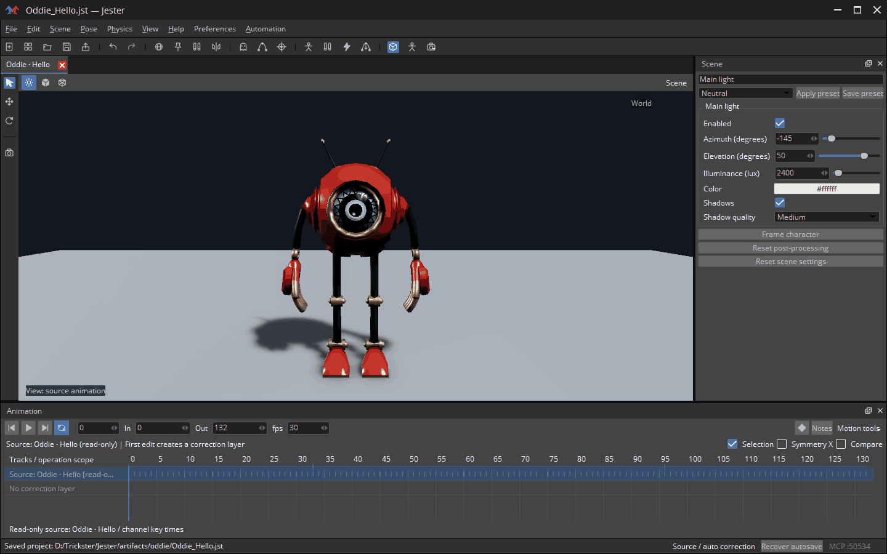
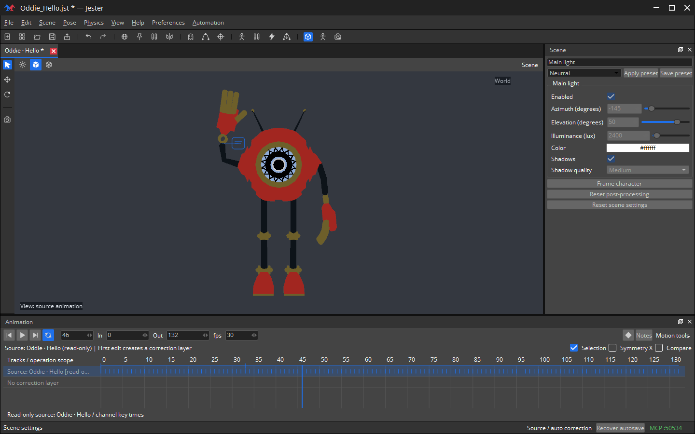
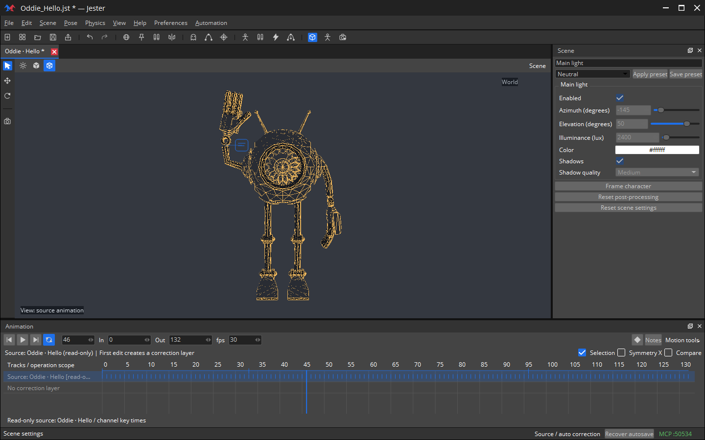
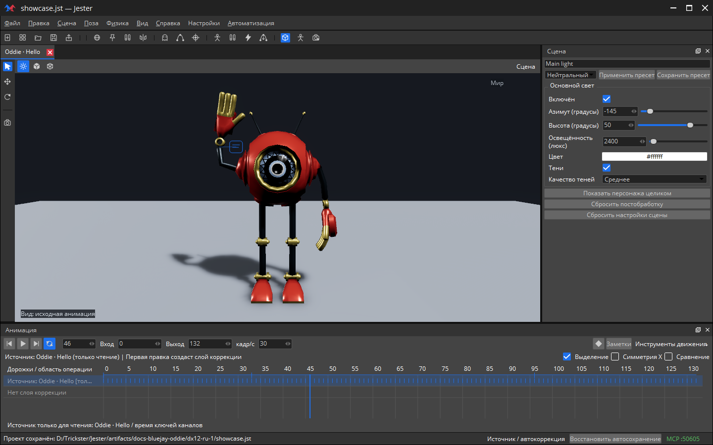
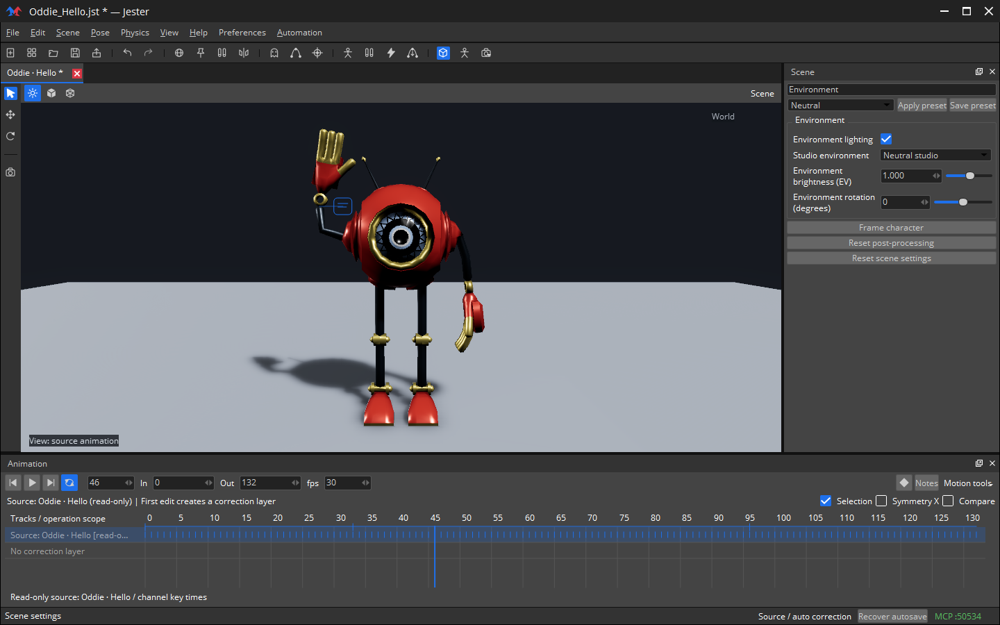
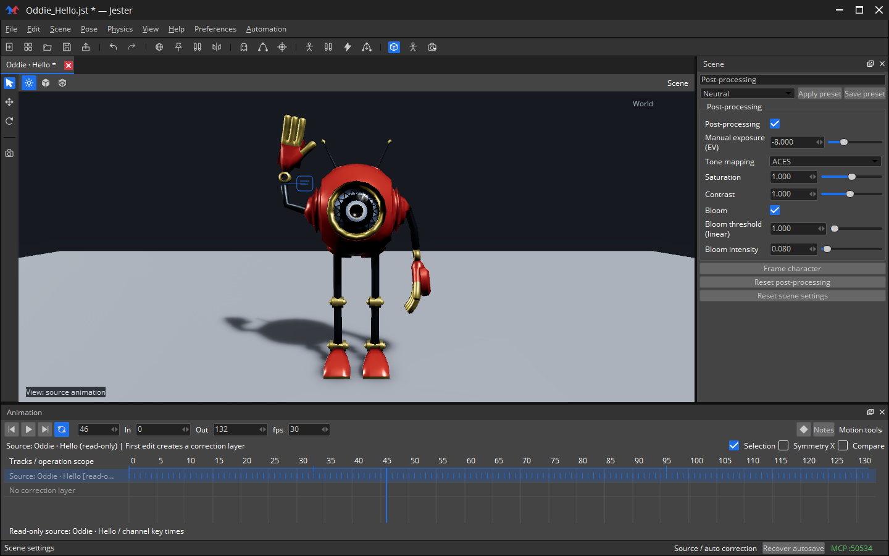
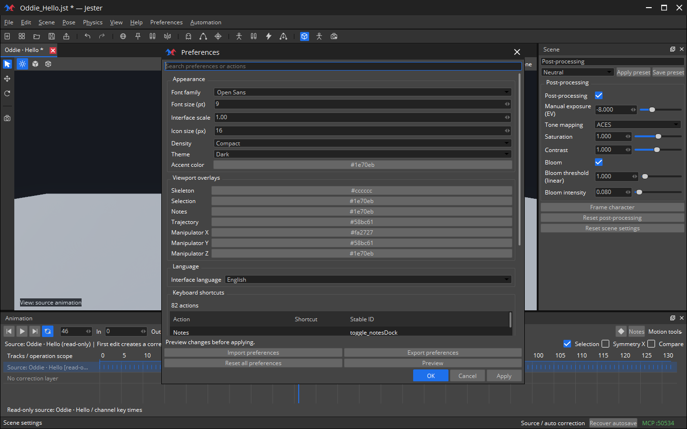
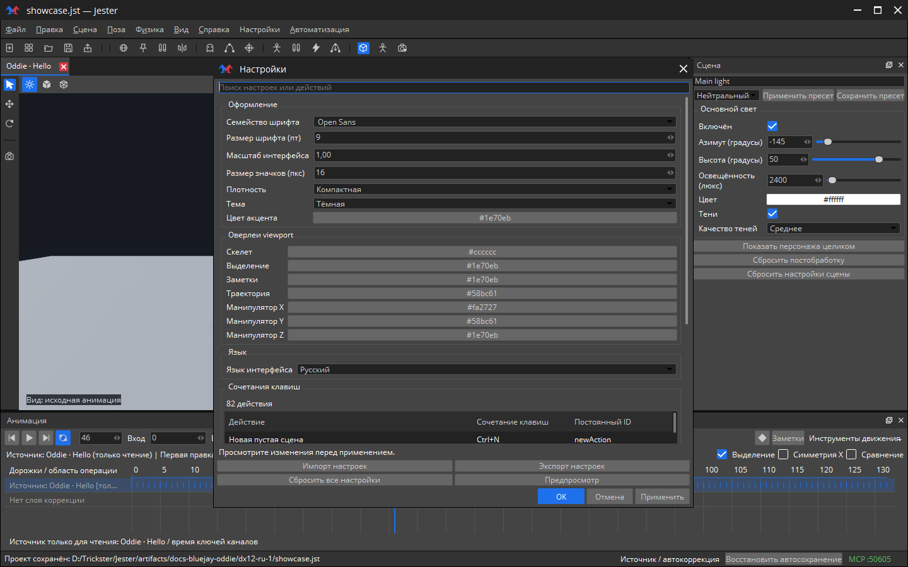
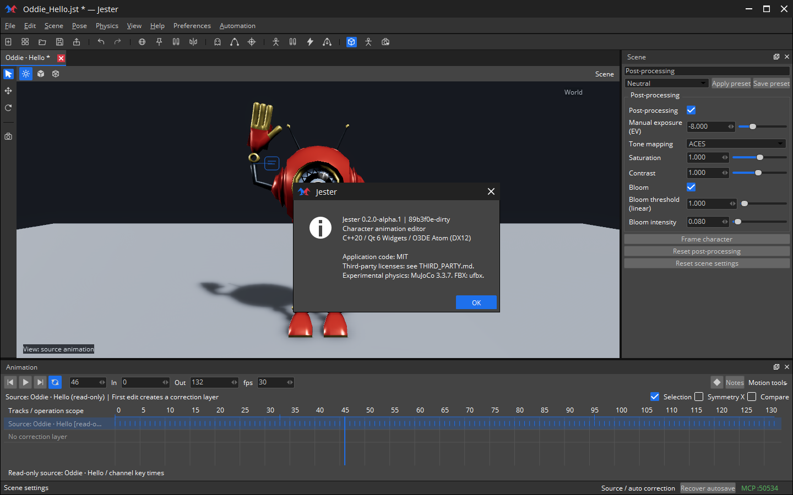
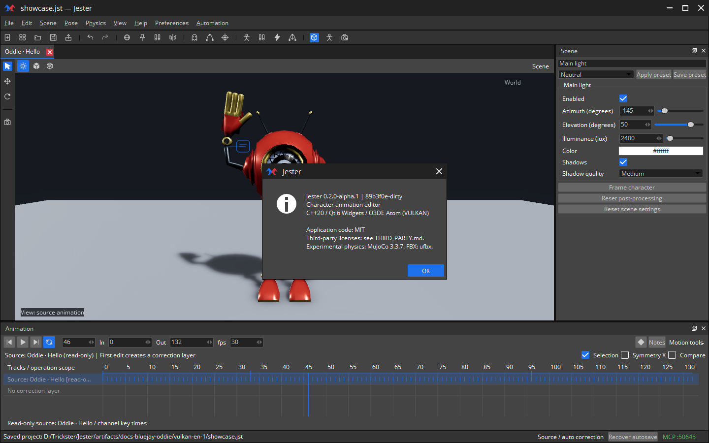

# Running editor

Real captures of the current **blue-accent Blue Jay interface**, recorded on **2026-10-26** from the **0.2.0-alpha.1** development tree, including the Unreleased note-card contrast fix. The UI has icon-only viewport modes and Loop, green active MCP status and red scene close buttons. The three mode images use the same Oddie character, pose, camera and authored materials. Captures combine the actual native Atom framebuffer and Qt UI, including the SDK title bar and Jester logo; no rendered mockups are used. PNGs are 1440 × 900. The English text entered in Russian search boxes is a user query. See [design sources](BLUE_JAY.md).

## Oddie greeting

A new 4.4-second greeting with three wrist waves, staggered finger motion and a return to the starting pose. The GIF records the editor window at 15 fps. The Jester project contains three bone-bound phase notes; see the [animation plan](ODDIE_WAVE.md). Oddie is a supplied character asset; its model is not included in the repository.

## Three viewport modes

Lit uses studio lighting, shadows and scene post effects.

Unlit preserves base color/UV/alpha with neutral display conversion.

Wireframe shows deformed triangle edges; skeleton display is disabled in these three captures.

## Scene controls

Russian main-light controls with illuminance in lux and main-light shadows.

Studio environment contribution is independent of the visible background.

Pipeline exposure, tone mapping and Bloom.

## Preferences and localization

Existing appearance/overlay preferences in English and Russian.

## Atom runtime identity

About reads the active RHI and compiled source identity. Runtime evidence also includes actual native-RHI registration logs, loaded Atom DLL paths and CPU/GPU output-buffer comparison; see [verification](VALIDATION.md) and [backend results](RENDER_BACKENDS.md).

The same current build reports Vulkan through its runtime query in a separate capture. These screenshots document the UI and active backend; broader validation of earlier builds remains documented separately in [packaging](PACKAGING.md).

## Animation notes

Current note cards and panels at 100% and 150% UI scale are shown in [Notes](NOTES.md#interface-examples). They describe the greeting's hand and finger motion.
